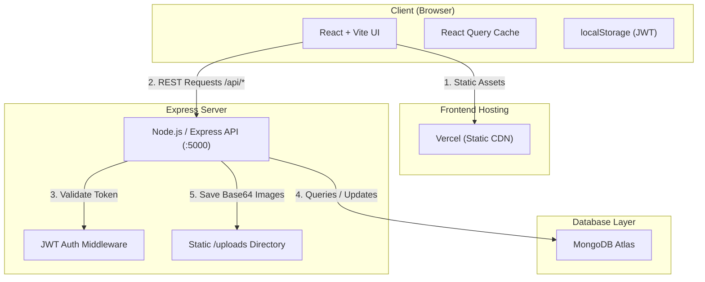

# Architecture & Data Flow

## Request Flow

### 1. Load Projects Page (`/my-work`)
1. User navigates to `/my-work`.
2. React Query triggers `GET /api/projects` via `apiFetch`.
3. Express matches public route in `server/routes/projects.js`, queries MongoDB `Project.find({ status: 'Published' }).sort({ displayOrder: 1 })`.
4. Express returns array of published project objects.
5. React renders `ProjectCard` components for each project.

### 2. Admin Adds Project
1. Admin opens `/admin/dashboard` -> `ProjectManager`.
2. Admin fills form (Case Study, Tech Stack, Images) and clicks Save.
3. If images uploaded, client calls `POST /api/upload` (returns URL `/uploads/...`).
4. Client calls `POST /api/projects` with `Authorization: Bearer <token>`.
5. Express `authMiddleware` validates JWT.
6. Express writes new `Project` document into MongoDB.
7. React Query invalidates `['admin-projects']` cache and updates UI.
